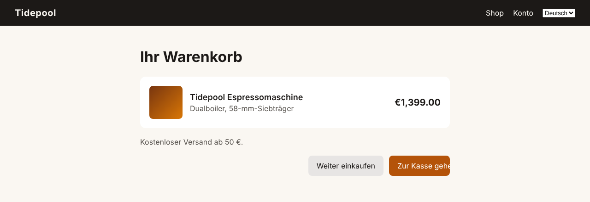
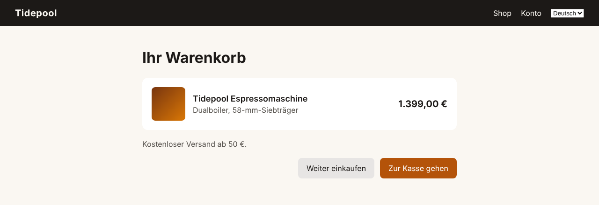
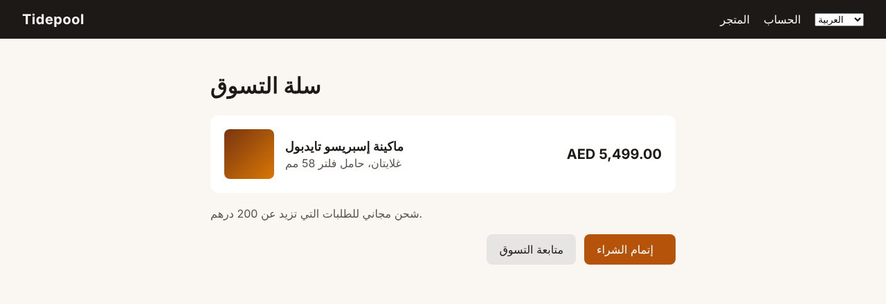
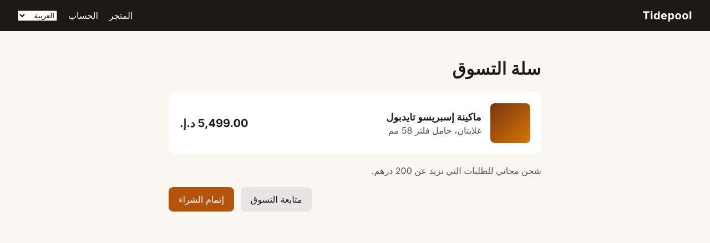
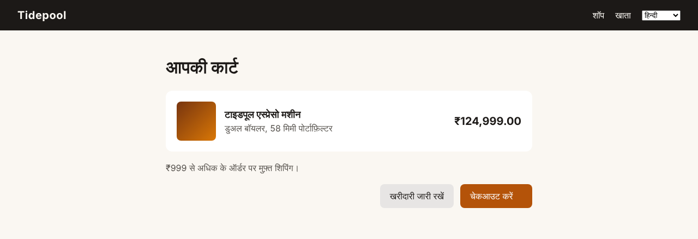
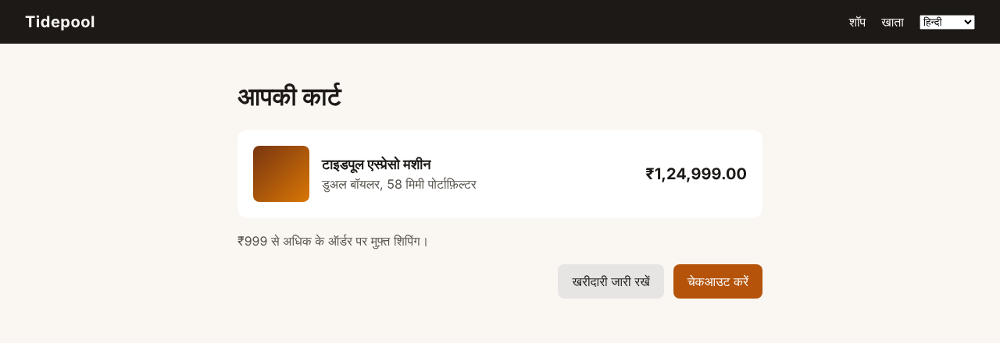
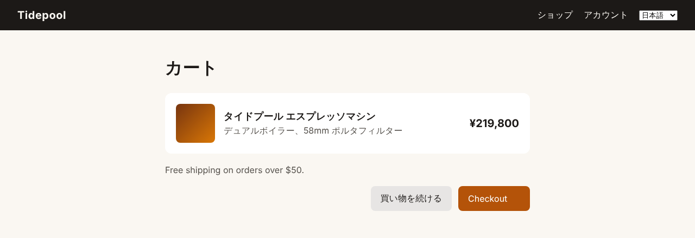
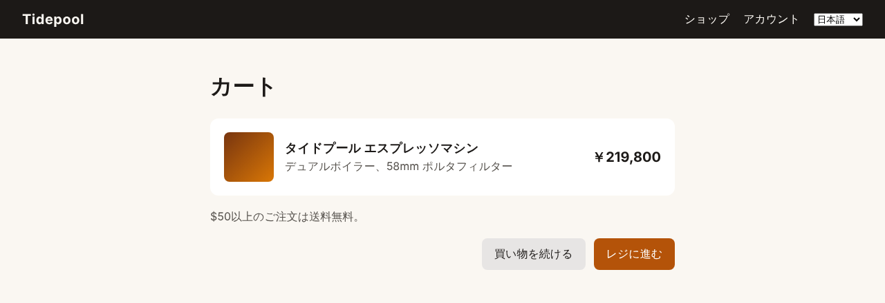
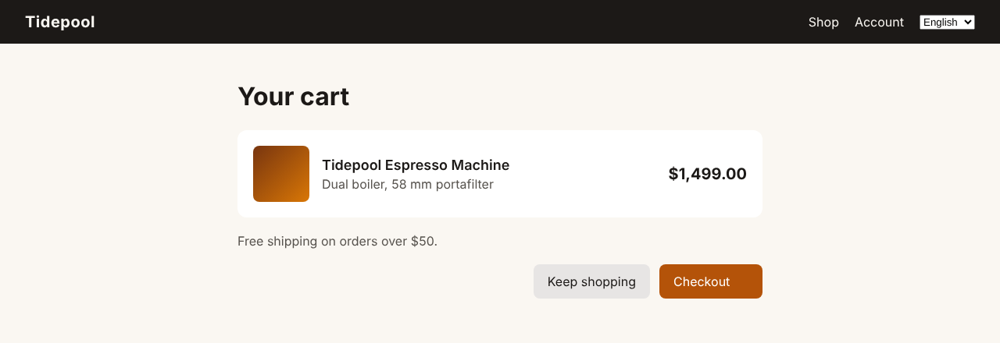

# Spillover

[](https://github.com/mystiquemide/spillover/actions/workflows/ci.yml)

**Catch the translation bugs that only show up on screen.**

Spillover opens every language version of your web app in real Chrome and has [Kane CLI](https://www.testmuai.com/kane-cli/) check what a user would actually see. When something is wrong, it hands the problems to your coding agent, then has Kane check again until every language passes.

Built for the [Kane CLI Online Hackathon](https://www.kaneclihack.sh/) by TestMu AI, November 2026.

**[Watch the 3-minute demo on YouTube](https://youtu.be/uGzMurFpZVc)**

[](https://youtu.be/uGzMurFpZVc)



*The German cart page as the agent first translated it. The checkout button is cut off mid-word ("Zur Kasse gehe") and the price uses the American format. Nothing in the HTML is wrong.*

---

## Contents

1. [About](#about)
2. [The problem, in plain words](#the-problem-in-plain-words)
3. [What Spillover found](#what-spillover-found)
4. [The fix loop](#the-fix-loop)
5. [Before and after](#before-and-after)
6. [How it meets the judging criteria](#how-it-meets-the-judging-criteria)
7. [Evidence](#evidence)
8. [Install, step by step](#install-step-by-step)
9. [Use it on your own app](#use-it-on-your-own-app)
10. [Commands](#commands)
11. [Config file](#config-file)
12. [How it works](#how-it-works)
13. [Kane CLI features used](#kane-cli-features-used)
14. [Tests](#tests)
15. [Honest notes and limits](#honest-notes-and-limits)
16. [What we built with](#what-we-built-with)
17. [Project layout](#project-layout)

---

## About

Spillover is a command-line tool for developers who ship their app in more than one language.

- **Who it's for:** anyone who has asked a coding agent to "add German, Arabic and Hindi" and then wondered whether it actually looks right.
- **What it does:** checks each language in a real browser, reports exactly what is broken and where, and can have a coding agent fix it.
- **What makes it different:** it checks the rendered screen, not the code. The bugs it finds are the ones unit tests, linters and text diffs can't see.
- **Name:** text that is too long for its box *spills over* the edge. That's the most common bug it catches.

## The problem, in plain words

**Localization** means adapting an app for other languages and countries. It's more than translating words:

| What changes | Example | What goes wrong |
|---|---|---|
| Length of text | German is about 30% longer than English | Buttons sized for "Checkout" cut off "Zur Kasse gehen" |
| Reading direction | Arabic and Hebrew read right to left | The whole page needs to be mirrored, or it reads backwards |
| Number format | Germany writes 1.399,00 €. India writes ₹1,24,999.00 | The right number in the wrong format looks broken or untrustworthy |
| Missing strings | A key nobody translated | The app silently falls back to English in the middle of a Japanese page |

Coding agents now translate a whole app in minutes. They don't look at the result. The HTML they produce is valid, every test passes, and the bug is still there, because **the bug only exists on the screen.**

That's exactly what Kane CLI is good at: it drives a real browser, reads what's rendered and can judge it visually.

## What Spillover found

We built a small demo store, **Tidepool Coffee** ([`demo-app/`](demo-app)), and translated it into German, Arabic, Hindi and Japanese the way an agent typically would. The mistakes in it are common, real-world localization bugs, and we put them there on purpose so there is something to catch.

One `spillover check` found all of them:

| Language | What was wrong | What Kane saw | Kane run |
|---|---|---|---|
| German (de) | Checkout button cut off: "Zur Kasse gehe" | Vision check: a button label is clipped | [05](evidence/kane-runs/05-check-all-de) |
| German (de) | Price `€1,399.00` | Read `€1,399.00`, expected `1.399,00 €` | [05](evidence/kane-runs/05-check-all-de) |
| Hindi (hi) | Price `₹124,999.00` | Read `₹124,999.00`, expected `₹1,24,999.00` (Indian lakh grouping) | [06](evidence/kane-runs/06-check-all-hi) |
| Arabic (ar) | Page laid out left to right | Vision check: heading starts on the wrong side | [04](evidence/kane-runs/04-check-all-ar) |
| Arabic (ar) | Price `AED 5,499.00` | Read `AED 5,499.00`, expected `5,499.00 د.إ.` | [04](evidence/kane-runs/04-check-all-ar) |
| Japanese (ja) | Shipping note still in English | Read "Free shipping on orders over $50." on the Japanese page | [03](evidence/kane-runs/03-check-all-ja) |
| Japanese (ja) | Checkout button still in English | Read "Checkout" on the Japanese page | [03](evidence/kane-runs/03-check-all-ja) |

**7 of 7 bugs caught. The 14 checks that should pass all passed, so no false alarms.**

The terminal output, copied exactly from round 1 of our recorded loop ([runs 07 to 10](evidence/kane-runs), [full log](examples/loop-run.txt)):

```
Kane CLI is checking de, ar, hi, ja in real Chrome...
FAIL ja  2 of 5 checks failed  (1.9 credits, 16s)
     x Missing translation for "cart.shipping". The page shows the source text "Free shipping on orders over $50.".
     x Missing translation for "cart.checkout". The page shows the source text "Checkout".
FAIL de  2 of 5 checks failed  (3.1 credits, 17s)
     x Price is not formatted for this locale. Expected "1.399,00 €", screen shows "€1,399.00".
     x A button label is cut off on screen. The translated text is wider than its button.
FAIL hi  1 of 5 checks failed  (3.0 credits, 23s)
     x Price is not formatted for this locale. Expected "₹1,24,999.00", screen shows "₹124,999.00".
FAIL ar  2 of 6 checks failed  (3.9 credits, 39s)
     x Price is not formatted for this locale. Expected "5,499.00 د.إ.", screen shows "AED 5,499.00".
     x The page is not laid out right-to-left. Set the document direction for RTL locales.

4 of 4 locales broken  ·  11.9 Kane credits  ·  report: .spillover/report.json
Brief for your coding agent: .spillover/brief.md
```

## The fix loop

`spillover loop` closes the loop between Kane and a coding agent:

```
  ┌──────────────┐   verdicts    ┌──────────────┐   brief.md    ┌──────────────┐
  │   Kane CLI   │ ────────────▶ │  Spillover   │ ────────────▶ │ Coding agent │
  │ judges each  │               │ compares and │               │ (Claude Code │
  │ locale in    │ ◀──────────── │ writes the   │ ◀──────────── │  by default) │
  │ real Chrome  │  re-check     │ brief        │  edits code   │              │
  └──────────────┘  failed only  └──────────────┘               └──────────────┘
```

What happened in our recorded run ([full output](examples/loop-run.txt)):

| Step | What happened | Result |
|---|---|---|
| Round 1, verify | Kane checked all 4 languages in parallel ([runs 07 to 10](evidence/kane-runs)) | 7 bugs in 4 languages |
| Round 1, fix | Claude Code read the [brief](examples/brief.md) and edited the app ([diff](examples/agent-fix.diff)) | 3 files changed |
| Round 2, verify | Kane re-checked the 4 broken languages ([runs 11 to 14](evidence/kane-runs)) | All 21 checks pass |

The agent fixed root causes, not symptoms:

- **One price fix for three countries.** It replaced the hard-coded American number format with `Intl.NumberFormat` and the right region per language. That fixed German, Hindi and Arabic at once.
- **Arabic direction.** It sets `dir="rtl"` on the page for right-to-left languages.
- **Cut-off button.** It removed the fixed width on the checkout button so the button fits its label.
- **Japanese.** It added the two missing strings.

The agent wasn't allowed to run commands, and it said so: *"None of the fixes have been run or checked against Kane."* Kane was the only thing in the loop that proved the fixes worked. That's the point of the tool.

## Before and after

Every screenshot below is the real demo page, at 1280 by 720, the size Spillover checks at. We took them after the Kane runs by loading the demo store with and without the [agent's diff](examples/agent-fix.diff) applied. Under each one is what was wrong and Kane's own verdict, copied word for word from its output, so you don't need to open any files.

### German (de)

**Before**


What was wrong:
- The orange checkout button is cut off. It shows "Zur Kasse gehe" instead of "Zur Kasse gehen".
- The price shows `€1,399.00`. Germans write `1.399,00 €`.

What Kane said ([run 05](evidence/kane-runs/05-check-all-de)):

```
FAIL  Reading the product price from the item card: value: '€1,399.00' -> '€1,399.00' after ['strip']; equals '1.399,00 €' -> FAIL
FAIL  Checking visibility of all button labels: value: 'false' -> 'false'; equals 'true' -> FAIL
```

Notice that Kane also read the button text as `'Zur Kasse gehen'` and passed that check, because the full word is there in the page. Only the visual check sees that the screen cuts it off.

**After the agent's fix**



What Kane said ([run 11](evidence/kane-runs/11-loop-round2-de)):

```
PASS  Reading the product price from the item card: value: '1.399,00 €' -> '1.399,00 €' after ['strip']; equals '1.399,00 €' -> PASS
PASS  Checking visibility of all button labels: value: 'true' -> 'true'; equals 'true' -> PASS
```

### Arabic (ar)

**Before**



What was wrong:
- The page is laid out left to right. Arabic reads right to left, so the heading, product and buttons should all be mirrored.
- The price shows `AED 5,499.00`, an English currency code in front. The Arabic format is `5,499.00 د.إ.`

What Kane said ([run 04](evidence/kane-runs/04-check-all-ar)):

```
FAIL  Reading the item card product price: value: 'AED 5,499.00' -> 'AED 5,499.00' after ['strip']; equals '5,499.00 د.إ.' -> FAIL
FAIL  Checking the main heading alignment: value: 'false' -> 'false'; equals 'true' -> FAIL
```

**After the agent's fix**



What Kane said ([run 14](evidence/kane-runs/14-loop-round2-ar)):

```
PASS  Reading the product price from the item card: value: '5,499.00 د.إ.' -> '5,499.00 د.إ.' after ['strip']; equals '5,499.00 د.إ.' -> PASS
PASS  Checking the right-to-left heading layout: value: 'true' -> 'true'; equals 'true' -> PASS
```

### Hindi (hi)

**Before**



What was wrong:
- The price shows `₹124,999.00`. In India large numbers are grouped in lakhs, so it should read `₹1,24,999.00`. Everything else on this page was correct.

What Kane said ([run 06](evidence/kane-runs/06-check-all-hi)):

```
FAIL  Reading the product price from the item card: value: '₹124,999.00' -> '₹124,999.00' after ['strip']; equals '₹1,24,999.00' -> FAIL
```

**After the agent's fix**



What Kane said ([run 13](evidence/kane-runs/13-loop-round2-hi)):

```
PASS  Reading the product price from the item card: value: '₹1,24,999.00' -> '₹1,24,999.00' after ['strip']; equals '₹1,24,999.00' -> PASS
```

### Japanese (ja)

**Before**



What was wrong:
- The shipping note is still in English: "Free shipping on orders over $50."
- The checkout button is still in English: "Checkout".
- Both keys were missing from the Japanese translation file, so the app quietly fell back to English.

What Kane said ([run 03](evidence/kane-runs/03-check-all-ja)). Spillover asked Kane whether the English text was showing, so these are Kane confirming the bug:

```
FOUND  Reading the product shipping note: value: 'Free shipping on orders over $50.' -> 'Free shipping on orders over $50.' after ['strip']; equals 'Free shipping on orders over $50.' -> PASS
FOUND  Reading the checkout button label: value: 'Checkout' -> 'Checkout' after ['strip']; equals 'Checkout' -> PASS
```

**After the agent's fix**



What Kane said ([run 12](evidence/kane-runs/12-loop-round2-ja)):

```
PASS  Reading the shipping note below the product: value: '$50以上のご注文は送料無料。' -> '$50以上のご注文は送料無料。' after ['strip']; equals '$50以上のご注文は送料無料。' -> PASS
PASS  Reading the checkout button label: value: 'レジに進む' -> 'レジに進む' after ['strip']; equals 'レジに進む' -> PASS
```

### English (reference)

The original English page, which has no bugs. The buttons were sized for these short English words, which is why the German one broke.



## How it meets the judging criteria

The hackathon has three bars that must be cleared, then four equally weighted scores.

| Bar | How Spillover clears it | Proof |
|---|---|---|
| It works end to end | One command takes a broken app to a verified fixed app | [loop-run.txt](examples/loop-run.txt) |
| Kane CLI caught or proved something | Kane caught 7 real bugs, including a clipped label that is invisible in the HTML | [runs 03 to 06](evidence/kane-runs) |
| The agent and Kane CLI talked to each other | Kane's verdicts become the agent's brief, and the agent's edits are re-verified by Kane | [brief.md](examples/brief.md), [runs 11 to 14](evidence/kane-runs) |

| Score | What we offer |
|---|---|
| **Ships** | Install, `spillover demo`, `spillover init` for your own app, CI exit codes. 43 automated tests. |
| **Verified** | Kane finds bugs only a rendered browser can show: clipped text, wrong layout direction, wrong number formats, English leaking into other languages. |
| **Closed loop** | Kane to brief to agent to Kane, re-checking only what failed. Two rounds from 7 bugs to zero. |
| **Craft** | Setup is detected for you, `doctor` explains every missing piece, it won't spend credits if your app is down, and the brief gives the agent clear instructions. |

## Evidence

Everything below is real output from this project, committed to this repository. Nothing is mocked.

### Kane CLI runs (16)

Each folder holds Kane's own `session.json` (objective, outcome, credits) and `events.ndjson` (Kane's raw output stream, including every verdict and the value Kane read off the screen). We removed nothing except Kane's UI log, which contains the account username.

Here is part of the last line of [run 05](evidence/kane-runs/05-check-all-de/events.ndjson), the German check, exactly as Kane wrote it. We show one of its five sub-checks, the price. `condition_results` are Kane's answers, and each sub-check shows the value Kane read off the screen and what it was compared with:

```json
{
  "type": "run_end",
  "status": "passed",
  "duration": 11.34,
  "condition_results": [
    true,
    true,
    true,
    false,
    false
  ],
  "condition_sub_checks": [
    {
      "description": "The product price on the right side of the item card reads '1.399,00 €'",
      "extracted_value": "€1,399.00",
      "expected_value": "1.399,00 €",
      "operator": "equals",
      "transforms": [
        "strip"
      ],
      "json_path": null
    }
  ],
  "credits_consumed": 2.42576
}
```

In analyzer mode, `"status": "passed"` means Kane finished judging the page. The verdicts are in `condition_results`, and here the last two are `false`: the price and the clipped button.

In the results column, `T` and `F` are Kane's answers to each condition, in order. For "untranslated" checks Spillover asks Kane whether the **English** text is on screen, so `T` there means the bug was seen (runs 03, 09, 16).

| # | Folder | What it was | Lang | Checks | Kane results | Credits | Time |
|---|---|---|---|---|---|---|---|
| 01 | [`01-probe`](evidence/kane-runs/01-probe) | Hand-built broken German page ([page](evidence/probe/index.html)), first test of Kane | de | 4 | F F T T | 5.85 | 17s |
| 02 | [`02-check-de`](evidence/kane-runs/02-check-de) | spillover check, German only | de | 5 | T T T F F | 6.93 | 22s |
| 03 | [`03-check-all-ja`](evidence/kane-runs/03-check-all-ja) | spillover check, all 4 languages in parallel | ja | 5 | T T T T T | 5.89 | 21s |
| 04 | [`04-check-all-ar`](evidence/kane-runs/04-check-all-ar) | spillover check, all 4 languages in parallel | ar | 6 | T T T F T F | 7.24 | 30s |
| 05 | [`05-check-all-de`](evidence/kane-runs/05-check-all-de) | spillover check, all 4 languages in parallel | de | 5 | T T T F F | 2.43 | 11s |
| 06 | [`06-check-all-hi`](evidence/kane-runs/06-check-all-hi) | spillover check, all 4 languages in parallel | hi | 5 | T T T F T | 6.02 | 19s |
| 07 | [`07-loop-round1-ar`](evidence/kane-runs/07-loop-round1-ar) | spillover loop, round 1, before the fix | ar | 6 | T T T F T F | 3.86 | 39s |
| 08 | [`08-loop-round1-de`](evidence/kane-runs/08-loop-round1-de) | spillover loop, round 1, before the fix | de | 5 | T T T F F | 3.08 | 17s |
| 09 | [`09-loop-round1-ja`](evidence/kane-runs/09-loop-round1-ja) | spillover loop, round 1, before the fix | ja | 5 | T T T T T | 1.88 | 16s |
| 10 | [`10-loop-round1-hi`](evidence/kane-runs/10-loop-round1-hi) | spillover loop, round 1, before the fix | hi | 5 | T T T F T | 3.03 | 23s |
| 11 | [`11-loop-round2-de`](evidence/kane-runs/11-loop-round2-de) | spillover loop, round 2, after the agent's fix | de | 5 | T T T T T | 2.76 | 21s |
| 12 | [`12-loop-round2-ja`](evidence/kane-runs/12-loop-round2-ja) | spillover loop, round 2, after the agent's fix | ja | 5 | T T T T T | 5.99 | 30s |
| 13 | [`13-loop-round2-hi`](evidence/kane-runs/13-loop-round2-hi) | spillover loop, round 2, after the agent's fix | hi | 5 | T T T T T | 2.01 | 16s |
| 14 | [`14-loop-round2-ar`](evidence/kane-runs/14-loop-round2-ar) | spillover loop, round 2, after the agent's fix | ar | 6 | T T T T T T | 2.60 | 26s |
| 15 | [`15-auto-strings-de`](evidence/kane-runs/15-auto-strings-de) | check with no string locations, as `spillover init` writes it | de | 8 | T T T T T T F F | 6.64 | 17s |
| 16 | [`16-auto-strings-ja`](evidence/kane-runs/16-auto-strings-ja) | check with no string locations, as `spillover init` writes it | ja | 8 | T T T T T T T T | 5.42 | 16s |

Total reported by Kane: **71.61 credits** over 16 runs.

### Screenshots (9)

[`evidence/screenshots/`](evidence/screenshots): before and after for German, Arabic, Hindi and Japanese, plus the English reference page.

### Loop artifacts (4)

| File | What it is |
|---|---|
| [`examples/loop-run.txt`](examples/loop-run.txt) | Full terminal output of `spillover loop`, including the agent's own summary |
| [`examples/brief.md`](examples/brief.md) | The brief Kane's verdicts produced, exactly as the agent received it |
| [`examples/agent-fix.diff`](examples/agent-fix.diff) | Every line the agent changed |
| [`examples/report-after-fix.json`](examples/report-after-fix.json) | Spillover's machine-readable report from the final, passing round |

### Probe page (1)

[`evidence/probe/index.html`](evidence/probe/index.html): the deliberately broken page used in run 01, our first test of whether Kane could see clipped text at all.

**30 pieces of evidence in total.** If you can't run Kane yourself, these are the recorded run.

## Install, step by step

You need three things on your computer. If you already have them, skip to step 4.

**1. Node.js 20 or newer.** Download it from [nodejs.org](https://nodejs.org). Check it with:

```bash
node --version
```

**2. Google Chrome.** From [google.com/chrome](https://www.google.com/chrome). Kane and Spillover both drive a real Chrome.

**3. A free TestMu AI account.** Sign up at [testmuai.com](https://www.testmuai.com). Kane CLI runs on credits from this account.

**4. Install Kane CLI and Spillover:**

```bash
npm install -g @testmuai/kane-cli github:mystiquemide/spillover
```

**5. Sign in to Kane:**

```bash
kane-cli login
```

This opens a sign-in prompt. If you'd rather use keys, find your username and access key in the TestMu AI dashboard under **Credentials** (sometimes **Account Settings, Keys**), then run `kane-cli login --username <user> --access-key <key>`. Treat the access key like a password.

**6. Check everything is ready:**

```bash
spillover doctor
```

You should see something like:

```
 ok  Node 22.23.5
 ok  Google Chrome
 ok  Kane CLI 0.10.9
 ok  Signed in to TestMu AI
 ok  99 Kane credits
 x   spillover.config.json missing
      spillover init
 ok  Claude Code (for spillover loop)
```

**7. Try the demo:**

```bash
spillover demo
```

This copies the Tidepool demo store, bugs included, into a `spillover-demo` folder and checks it. It costs about 20 to 30 Kane credits. To watch an agent fix it:

```bash
cd spillover-demo
spillover loop
```

`spillover loop` uses [Claude Code](https://www.anthropic.com/claude-code) by default, so you need it installed and signed in for this step. `check` doesn't need an agent.

## Use it on your own app

```bash
cd your-app
spillover init --url "http://localhost:3000/?lang={locale}"
```

Replace the address with wherever your app runs locally, and put `{locale}` where the language code goes. For example `http://localhost:3000/{locale}/` if your app uses paths like `/de/`.

`init` looks for your translation files in the usual places (`locales/`, `public/locales/`, `src/i18n/`, `messages/` and more). It understands both common layouts:

- one file per language: `locales/de.json`
- one folder per language: `public/locales/de/common.json` (i18next style)

It also detects right-to-left languages (Arabic, Hebrew, Persian, Urdu and others) and any price fields shaped like `{ "amount": 49, "currency": "USD" }`.

Then start your app and run:

```bash
spillover check
```

If your app isn't running, Spillover says so and stops **before** spending any Kane credits.

## Commands

| Command | What it does | Costs Kane credits |
|---|---|---|
| `spillover demo` | Copies the demo store into `./spillover-demo` and checks it | Yes, about 20 to 30 |
| `spillover init [--url <address>] [--force]` | Finds your translation files and writes `spillover.config.json` | No |
| `spillover doctor` | Checks Node, Chrome, Kane CLI, sign-in, credits and config | No |
| `spillover check [languages...]` | Checks every language, or only the ones you name, e.g. `spillover check de ar` | Yes, a few per language |
| `spillover loop [--rounds N] [--agent "<command>"]` | Check, hand failures to the agent, re-check failed languages only. Default 3 fix rounds | Yes |

**Exit codes**, for scripts and CI: `0` every language passes, `1` a language is broken, `2` setup problem (no config, app down, Kane not signed in).

**Using another agent.** Any command that takes its prompt on standard input works:

```bash
spillover loop --agent "<your agent command>"
```

**Output files**, in `.spillover/`:

- `report.json`: every check, what Kane read and Kane's reasoning
- `brief.md`: the agent's instructions, written only when something fails
- `<language>.png`: a screenshot of each page that was checked

## Config file

`spillover init` writes this for you. A complete example, the one the demo uses:

```json
{
  "url": "http://127.0.0.1:4173/?lang={locale}",
  "serve": "demo-app",
  "catalog": "demo-app/locales/{locale}.json",
  "source": "en",
  "fixScope": ["demo-app/"],
  "locales": {
    "de": { "intl": "de-DE" },
    "ar": { "intl": "ar-AE", "dir": "rtl" },
    "hi": { "intl": "hi-IN" },
    "ja": { "intl": "ja-JP" }
  },
  "strings": {
    "cart.title": "main page heading",
    "cart.shipping": "shipping note below the product",
    "cart.checkout": "orange checkout button"
  },
  "price": { "key": "price", "element": "product price on the right side of the item card" }
}
```

| Field | Required | Meaning |
|---|---|---|
| `url` | Yes | Address of each language's page. `{locale}` is replaced with the language code |
| `catalog` | Yes | Path to each language's translation file |
| `locales` | Yes | Languages to check. `intl` sets the number format region, `dir: "rtl"` adds the right-to-left check |
| `source` | No | The original language, default `en` |
| `strings` | No | Translation keys and where they appear, in plain English. Without it, Spillover picks up to 6 visible strings and Kane looks for them anywhere on the page |
| `price` | No | A price in the catalog (`amount` and `currency`) and where it appears |
| `serve` | No | A folder to host as a static site, so you don't need to start a server |
| `fixScope` | No | Folders the agent is allowed to edit |
| `parallel` | No | How many languages to check at once, default 4 |
| `viewport` | No | Browser size, default 1280 by 720 |
| `agent` | No | Agent command for `loop` |

## How it works

For each language, in parallel:

1. **Open the page.** Spillover launches a real Chrome with a debugging port and loads the language's URL. It waits for the page and fonts to finish loading, then saves a screenshot.
2. **Build the checks.** From the translation files it creates plain-English conditions such as:
   - `The orange checkout button reads 'Zur Kasse gehen'`
   - `The product price on the right side of the item card reads '1.399,00 €'`, where the expected price comes from the browser's own `Intl.NumberFormat` for that region
   - `Every button label on the page is fully visible, with no words cut off or clipped by the button edge`
   - `The page is laid out right-to-left...` for Arabic, Hebrew and similar
   - For a key missing from the catalog, it asks whether the **English** text is showing instead
3. **Ask Kane.** Spillover runs Kane CLI against that same Chrome:
   ```bash
   kane-cli run --analyzer-only --agent --assertion-mode visual \
     --cdp-endpoint http://127.0.0.1:<port> --condition "..." --condition "..."
   ```
   Kane looks at the live page and answers every condition. For text, it reports the exact value it read off the screen.
4. **Judge.** For text and prices, Spillover compares the value Kane read against the expected value itself, ignoring harmless differences like non-breaking spaces and invisible direction marks. For visual checks, Kane's verdict decides.
5. **Report.** Results go to the terminal, `report.json` and, if anything failed, `brief.md`.

`loop` repeats this. After each fix it re-checks only the languages that failed, to save credits.

The code is small, about 750 lines with one dependency (`playwright-core`, to drive Chrome):

| File | Job |
|---|---|
| [`src/expect.js`](src/expect.js) | Builds checks from catalogs and judges Kane's answers |
| [`src/kane.js`](src/kane.js) | Runs Kane CLI and parses its NDJSON output |
| [`src/browser.js`](src/browser.js) | Opens Chrome with a debugging port Kane can attach to |
| [`src/run.js`](src/run.js) | `check` and `loop` |
| [`src/setup.js`](src/setup.js) | `init`, `doctor` and `demo` |
| [`src/report.js`](src/report.js) | Terminal output and the agent's brief |
| [`src/serve.js`](src/serve.js) | Tiny static server for `serve` |

## Kane CLI features used

| Feature | How Spillover uses it |
|---|---|
| `kane-cli run --agent` | Machine-readable NDJSON output that Spillover parses |
| `--analyzer-only` with `--condition` | Judges many conditions against a page in one run, with no clicking, so each language costs one short run |
| `--assertion-mode visual` | Uses Kane's vision model, which is what catches clipped labels and wrong layout direction |
| `--cdp-endpoint` | Kane attaches to the exact Chrome window Spillover opened and screenshotted |
| `run_end` fields `condition_results`, `condition_reasons`, `condition_sub_checks` | The verdicts, Kane's reasoning and the values it read off the screen |
| `credits_consumed` | Shown per language and per round |
| Exit codes and `error` events | Turned into plain error messages |
| `kane-cli whoami`, `balance`, `--version` | Used by `spillover doctor` |

Kane features we did **not** use, to be clear about scope: saved `*_test.md` tests and `testrun`, Browser Cloud (`--ws-endpoint`), real mobile devices, the assurance commands (`context`, `design`, `cover`), evidence packs and `--bug-detection`. Analyzer mode saves no evidence pack, so our evidence is Kane's session files listed above.

## Tests

43 automated tests, all passing. They use no Kane credits and no network.

```bash
npm install
npm test
```

[GitHub Actions](.github/workflows/ci.yml) runs them on Node 20, 22 and 24 for every push and pull request, then packs and installs the CLI and checks `spillover --help`, `spillover init` and the no-credits-spent path of `spillover check`.

| File | Tests | What they cover |
|---|---|---|
| [`test/expect.test.js`](test/expect.test.js) | 17 | Lakh grouping, euro and yen formats, building checks for each case, untranslated strings, RTL, and judging what Kane read |
| [`test/kane.test.js`](test/kane.test.js) | 5 | Replays a **real recorded Kane run** through the parser, checks the exact flags sent to Kane, Kane errors, Kane not installed |
| [`test/report.test.js`](test/report.test.js) | 5 | The agent's brief and the summary counts |
| [`test/serve.test.js`](test/serve.test.js) | 4 | The static server, including refusing paths outside its folder |
| [`test/cli.test.js`](test/cli.test.js) | 6 | Help, unknown commands, missing config, app down with no credits spent, `init` end to end |
| [`test/setup.test.js`](test/setup.test.js) | 6 | Finding translation files in both layouts, region detection, picking visible strings |

The end-to-end proof that Spillover and Kane work together is the 16 real Kane runs in [Evidence](#evidence). Those cost real credits, so they aren't part of `npm test`.

## Honest notes and limits

We'd rather you hear these from us.

**About the demo**
- The bugs in the demo store were put there by us on purpose. They're realistic and common, but this isn't a production app someone else shipped.
- Kane's answers come from AI models, so they can vary slightly between runs. In our 16 runs, every planted bug was caught every time it was checked, and no correct text was ever flagged.

**What we learned while building**
- In our very first test ([run 01](evidence/kane-runs/01-probe)), Kane **missed** an English sentence on a German page when we asked a vague question ("is all text German?"). That's why Spillover never asks Kane to judge language. It asks Kane to read specific text and compares it in code.
- When Spillover doesn't know where a string sits on the page, it asks Kane whether the text is shown anywhere. Kane answers that from the page content, so it can say yes even when the text is visually cut off ([run 15](evidence/kane-runs/15-auto-strings-de), the German button). The separate visual check still caught the clipping in the same run.
- The visual "fully visible" check answers for the whole page. It tells you a label is clipped, not which one. The screenshot and brief help the agent find it.
- Kane printed `--analyzer-only ignores --url`. Spillover doesn't rely on that flag: it loads the page itself and hands Kane the open browser.

**Credits**
- Kane's own reports add up to 71.61 credits for our 16 runs. Our account balance went from 200 to 99.07 over the same period, which is 100.93 credits. We can't account for the difference of about 29 credits. Budget more than Spillover's totals suggest.
- One language check costs roughly 2 to 7 credits. A full demo loop is about 25 to 45.

**About the agent**
- `spillover loop` uses Claude Code on the Sonnet model by default. We picked Sonnet because it's quick and cheap for this kind of edit, and because our account's default model was out of usage when we built the loop.
- The agent is only allowed to read and edit files in our default setup, so it can't verify its own fixes. That's deliberate: Kane is the one that verifies.

**Scope**
- One page per language. Checking multi-step flows (cart, then checkout, then confirmation) in every language is the obvious next step.
- Prices are checked only when the catalog stores them as `amount` plus `currency`.
- Kane runs were tested on Linux with Chrome 158, Node 22 and Kane CLI 0.10.9. CI runs the tests on Node 20, 22 and 24 on Linux. Not yet tested on macOS or Windows.
- Needs Node 20 or newer, because Playwright 1.63 does.

## What we built with

| Tool | Role |
|---|---|
| [Kane CLI](https://www.testmuai.com/kane-cli/) 0.10.9 by TestMu AI | Judges every rendered page. The core of the product |
| [Claude Code](https://www.anthropic.com/claude-code) | The coding agent we used to build Spillover, and the default agent in `spillover loop` |
| [Playwright](https://playwright.dev) (`playwright-core`) | Opens Chrome and takes screenshots |
| Node.js | Runtime. No build step, no framework |

This project was built during the hackathon, with all commits on or after 12 November 2026.

## Project layout

```
bin/spillover.js         the spillover command
src/                     the tool itself (see "How it works")
test/                    43 automated tests, plus a recorded Kane run used as a fixture
demo-app/                Tidepool Coffee, the demo store, with its bugs
spillover.config.json    config for the demo store
examples/                the recorded fix loop: output, brief, diff, final report
evidence/kane-runs/      16 real Kane CLI sessions
evidence/screenshots/    before and after, per language
evidence/probe/          the page from our first Kane test
```

## License

[MIT](LICENSE)
